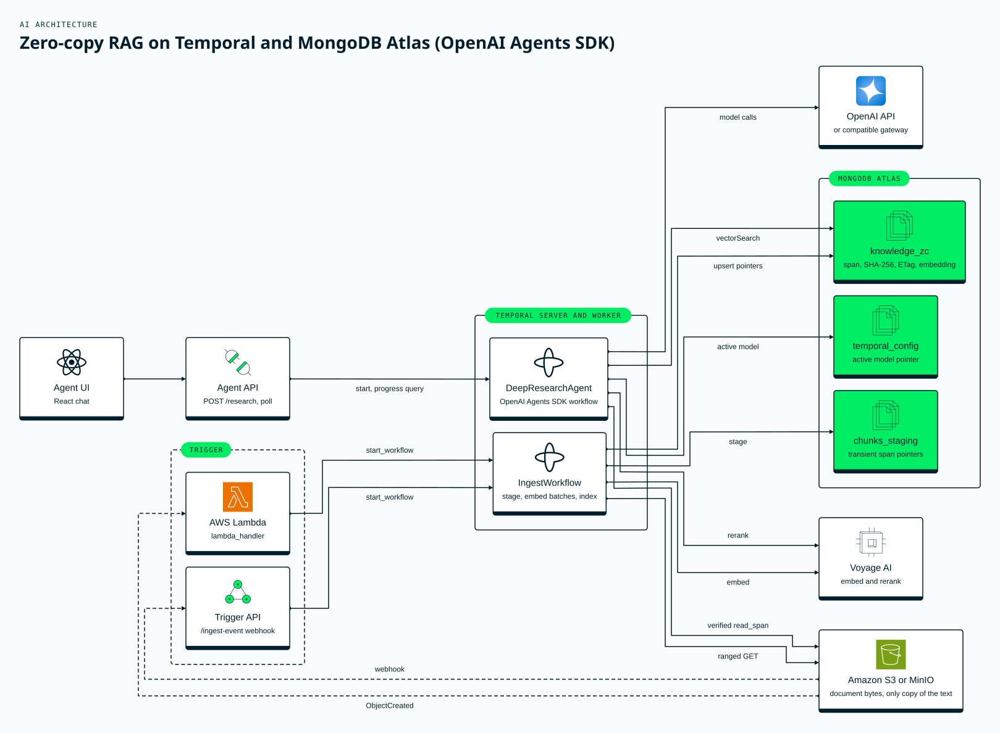
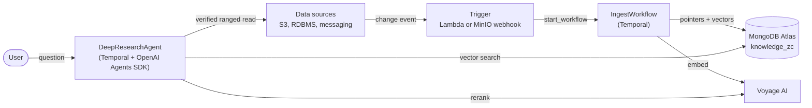
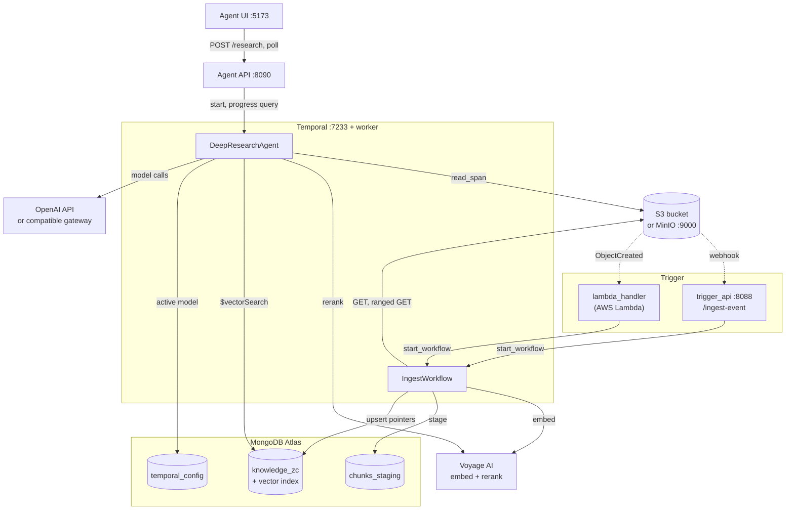
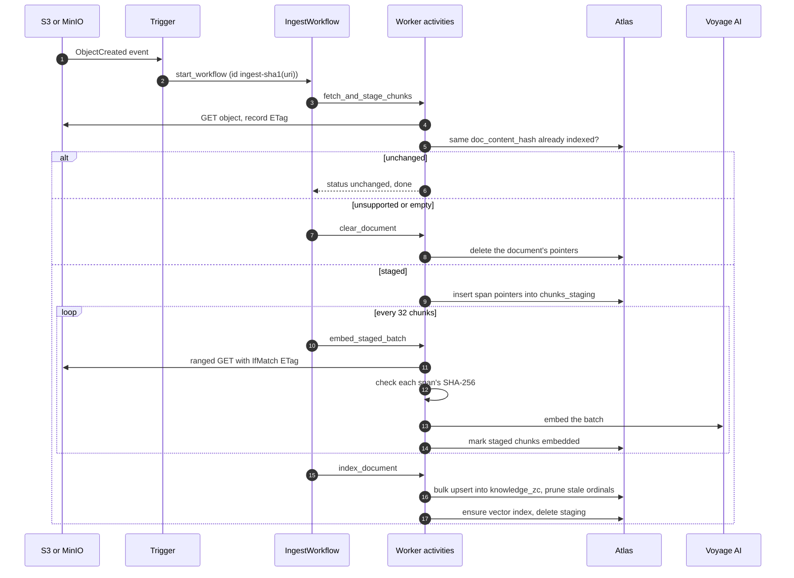
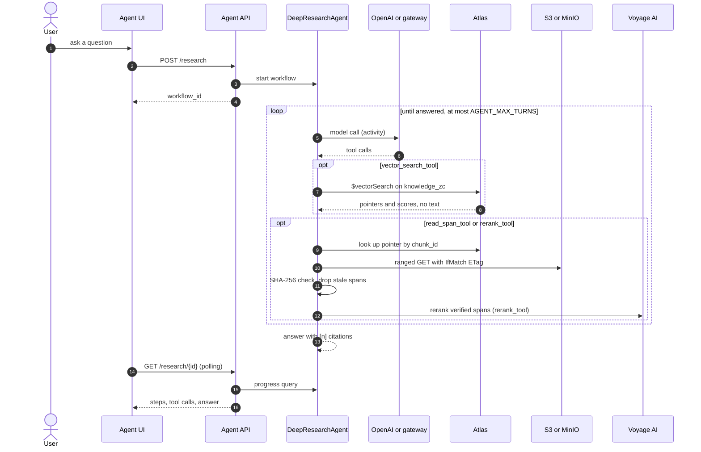

# MongoDB × Temporal: Partner Reference Architecture

A reference implementation of **Temporal** and **MongoDB Atlas** together: a durable,
change-driven RAG pipeline with a research agent on top.

This branch is **zero-copy RAG**. Atlas holds each chunk's embedding and a pointer back to its
bytes in S3, never the text itself. The agent finds chunks by vector search, then reads the exact
bytes from S3 and checks them against a SHA-256 taken at index time before it uses them.

> **Developers:** see [docs/RUNBOOK.md](docs/RUNBOOK.md) for prerequisites, API key setup,
> local spin-up, and cloud infra references.

---

## What is Temporal?

[Temporal](https://temporal.io) is a **durable execution platform**. It runs long-lived workflows
as ordinary code, with retries, checkpointing and resume-on-failure built in. You write plain
Python functions, and Temporal runs them to completion through crashes, deploys and network
partitions.

In this architecture Temporal owns two concerns:

| Concern            | What Temporal guarantees                                                                                                                                                                  |
| ------------------ | ----------------------------------------------------------------------------------------------------------------------------------------------------------------------------------------- |
| Ingestion pipeline | A crash mid-embedding resumes from the last completed batch and never re-embeds finished chunks ([durable execution](https://docs.temporal.io/evaluate/major-advantages#fault-oblivious-code)) |
| Agent workflows    | Every model and tool call is a history event, so a failure mid-run resumes without losing tool results ([workflows as code](https://docs.temporal.io/workflows))                        |

---

## The problem this solves

Customers hand-roll resilient ingestion and embedding pipelines, and it hurts:

| Customer   | Pain hand-rolled without Temporal                                        |
| ---------- | ------------------------------------------------------------------------ |
| Customer A | MD5 change-tracking in production to decide what to re-embed             |
| Customer B | A homegrown "lambda clock" cron to generate embeddings                   |
| Customer C | A FastAPI pipeline, hand-tuning sequential vs. parallel                  |
| Customer D | A 5-hour import that fails on the last step **reruns the entire import** |

This PRA packages the pattern that removes that pain. It is already in production at several
enterprise customers.

Zero-copy adds a second benefit. The document text stays in the bucket you already govern, and
Atlas never holds a copy of it. When an object changes or disappears, the agent sees that on its
next read instead of citing a stale copy.

---

## Partner Solutions Architecture




### High-level design



Temporal brings durability to both halves: the pipeline that ingests content and the agent that
answers from it.

**How to read it:**

1. A change in a **data source** (S3 here; RDBMS or messaging through the same trigger seam)
   starts a workflow in Temporal directly.
2. **Temporal** chunks the content, calls **Voyage AI** for embeddings, and upserts pointers and
   vectors into **Atlas**. No chunk text is written.
3. A **durable research agent** (OpenAI Agents SDK, running as a Temporal workflow) searches
   Atlas, reads the matching byte ranges back from the source, and answers with citations.

> **Design note:** the direct trigger (S3 straight to the ingest workflow) relies on Temporal's
> durable execution for the "don't lose the event once the workflow starts" guarantee. If you
> already run change data capture through Kafka, see the
> [with-kafka](https://github.com/mongodb-partners/mdb-temporal-pra/tree/with-kafka) branch.

### Division of responsibility

| Concern                                                | Owner                   |
| ------------------------------------------------------ | ----------------------- |
| Orchestration, retries, checkpointing, resumability    | **Temporal**            |
| Pointers, vector index, active-model pointer           | **MongoDB Atlas**       |
| Document bytes (the only copy of the text)             | **S3** (or MinIO)       |
| Embeddings and reranking                               | **MongoDB Voyage AI**   |
| Agent reasoning and answers                            | **OpenAI (Agents SDK)** |

---

## System architecture



### Atlas data model

Database `temporal` by default (`MONGODB_DB`):

| Collection        | Holds                                                                                       |
| ----------------- | ------------------------------------------------------------------------------------------- |
| `chunks_staging`  | Pointers between ingest stages. Transient: deleted once a document is indexed               |
| `knowledge_zc`    | One document per chunk: byte span, content hash, embedding, S3 bucket, key and ETag. No text |
| `temporal_config` | The `active` document naming the collection, index and embedding model retrieval uses       |
| `agent_memory`    | Reserved for agent memory. Nothing writes to it yet                                         |

Retrieval and the pipeline share one database, so there is no sync lag between what ingestion
writes and what the agent searches. The text lives in exactly one place, the bucket.

---

## Ingestion

Ingestion turns an object landing in storage into searchable pointers, durably and **without a
message broker**. An S3 **ObjectCreated** event starts a Temporal `IngestWorkflow` directly: an
AWS Lambda against real S3, or the MinIO webhook locally. Both go through the same
`handle_s3_event`. Once `start_workflow` returns, the change is safe. Temporal carries the
workflow to completion across retries, worker restarts and maintenance.

- **The trigger is a thin adapter** (`pipeline/lambda_handler.py` or `POST /ingest-event`).
  Temporal's durable execution provides the "don't lose the event" guarantee.
- **Pointers, not text.** The Markdown extractor splits on headings and windows long sections.
  Each chunk is recorded as a byte span into the unmodified object plus a SHA-256 of those bytes.
  Other file types are refused, and the document is cleared rather than half indexed.
- **Idempotent, update-in-place.** A whole-object hash skips unchanged uploads. An edited object
  re-embeds and upserts in place, and chunks the new version no longer has are pruned.
- **Batched and resumable.** Chunks embed 32 at a time: one ranged GET (guarded by the ETag) and
  one Voyage call per batch. A crash resumes at the first unfinished batch. More worker processes
  on the same task queue scale it out.
- **Output.** Pointer documents in `knowledge_zc` with an Atlas Vector Search index. Internals are
  in [docs/LLD.md](docs/LLD.md) §5 and §6.

### Ingestion sequence diagram



---

## The agent

The agent answers questions over the ingested documents as a **durable Temporal workflow**
(`DeepResearchAgent`) built with the **OpenAI Agents SDK**. It is not a fixed
retrieve, rerank, answer chain. The model gets the retrieval steps as **tools** and decides which
to call and how often.

- **Tools.** `vector_search_tool` returns pointers and scores, no text. `read_span_tool` reads one
  chunk's bytes from S3 and returns them only if they still match the index-time hash; otherwise
  it returns `stale`, `missing` or `unknown`. `rerank_tool` reads and verifies the candidates the
  same way, then reranks only the ones that verified. All three are Temporal activities.
- **Grounded.** The instructions forbid answering from the model's own background knowledge. If
  the knowledge base has nothing relevant, the agent says so.
- **Web search** is added when `OPENAI_USE_RESPONSES=true` (the default with api.openai.com). A
  gateway that only offers Chat Completions runs without it.
- **Durable and auditable.** The reasoning loop _is_ a workflow, so every model and tool call is a
  history event you can inspect in the Temporal UI. Independent tool calls in one turn run as
  concurrent activities. A run that hits `AGENT_MAX_TURNS` (12 by default) fails cleanly instead
  of retrying forever.
- **Live progress.** Run hooks record readable steps. The UI starts a run with `POST /research`
  and polls `GET /research/{id}`, which reads a workflow query. Progress is step level, not token
  streaming.
- **Opt-in.** The agent loads only when `OPENAI_API_KEY` is set. Ingestion runs without it.

### Sequence: research query



---

## Quickstart (local demo)

**Prerequisites:** `uv`, Docker, Temporal CLI, and Node 20+. See
[docs/RUNBOOK.md → Prerequisites](docs/RUNBOOK.md#prerequisites) for install commands.

The app reads one dotenv file, `.env` unless you pass `ENV_FILE`. Pick a storage mode:

- **AWS S3** (`.env`): set `S3_BUCKET` and AWS credentials, leave `S3_ENDPOINT_URL` blank.
- **Local MinIO** (`.env.minio`): set `S3_ENDPOINT_URL=http://localhost:9000`, the `minioadmin`
  credentials and `S3_BUCKET=temporal-datasources`, then add `ENV_FILE=.env.minio` to each
  `make` command. Give it its own `MONGODB_DB` so local pointers never mix with pointers into
  the AWS bucket.

```bash
# 1. Clone and enter the repo
git clone https://github.com/mongodb-partners/mdb-temporal-pra.git
cd mdb-temporal-pra

# 2. Copy and fill in credentials
cp .env.example .env
# Edit .env: set MONGODB_URI, VOYAGE_API_KEY, OPENAI_API_KEY and the S3 settings

# 3. Install all dependencies (Python + UI)
make setup

# 4. Start Temporal, worker, trigger API, agent API and UI
#    (with ENV_FILE=.env.minio this also starts MinIO and wires its webhook)
make start

# 5. Create the Atlas Vector Search index (one-time)
make index

# 6. Seed the sample document (seed/ethical_governance.md)
make seed

# 7. Open the agent UI
open http://localhost:5173

# 8. Tear everything down
make stop
```

`make help` lists all available targets.

| Service         | URL                   | Notes                                             |
| --------------- | --------------------- | ------------------------------------------------- |
| Agent chat UI   | http://localhost:5173 |                                                   |
| Temporal Web UI | http://localhost:8233 |                                                   |
| Agent API       | http://localhost:8090 | `POST /research`, `GET /research/{id}`            |
| Trigger API     | http://localhost:8088 | `/ingest-event` (S3 envelope), `/ingest-trigger`  |
| MinIO console   | http://localhost:9001 | MinIO mode only. `minioadmin` / `minioadmin`      |

---

## Repo layout

```text
mdb-temporal-pra/
├── README.md
├── Makefile                        ← all dev commands (make help); ENV_FILE picks the dotenv file
├── pyproject.toml                  ← Python deps managed by uv
├── .env.example                    ← copy to .env (or .env.minio) and fill credentials
├── seed/                           ← sample Markdown documents (make seed)
├── tests/                          ← pytest (uv run pytest)
├── agent/
│   ├── api.py                      ← FastAPI: /research start + poll (:8090)
│   ├── agent_workflow.py           ← DeepResearchAgent (OpenAI Agents SDK loop as a workflow)
│   ├── provider.py                 ← model provider: OpenAI directly or a compatible gateway
│   ├── tools.py                    ← vector_search_tool, read_span_tool, rerank_tool (activities)
│   └── ui/                         ← React/Vite chat UI (:5173)
├── pipeline/
│   ├── worker.py                   ← Temporal worker process
│   ├── trigger.py                  ← shared handle_s3_event → start IngestWorkflow
│   ├── trigger_api.py              ← webhook /ingest-event + manual /ingest-trigger
│   ├── lambda_handler.py           ← AWS Lambda entrypoint for real S3 (same handler)
│   ├── retrieval.py                ← $vectorSearch returning pointers
│   ├── spanio.py                   ← the only ranged reader: fetch_range, read_span
│   ├── workflows/
│   │   ├── ingest_workflow.py      ← IngestWorkflow: stage → embed batches → index
│   │   └── backfill_workflow.py    ← BackfillWorkflow (deferred on zero-copy)
│   ├── activities/
│   │   ├── ingest.py               ← stage, embed, index and clear activities
│   │   └── backfill.py             ← fails fast: there is no stored text to re-embed
│   ├── extractors/                 ← Markdown extractor producing byte spans
│   ├── config_store.py             ← active collection/index/model pointer
│   └── search_index.py             ← idempotent Atlas Vector Search management
└── infra/
    ├── docker-compose.yml          ← MinIO + bucket/webhook setup (MinIO mode)
    └── atlas_indexes.json          ← Vector Search index definitions
```

---

## Developer guide

| Document                                   | Description                                                                          |
| ------------------------------------------ | ------------------------------------------------------------------------------------ |
| **[docs/RUNBOOK.md](docs/RUNBOOK.md)**     | Prerequisites, API key setup, local spin-up (S3 or MinIO), cloud infra references     |
| **[docs/LLD.md](docs/LLD.md)**             | Low-level design: data contracts, workflow internals, zero-copy retrieval, scaling    |
| **[docs/decisions/](docs/decisions/)**     | Architecture Decision Records, e.g. ADR 0001 (direct-from-S3 triggering)             |
