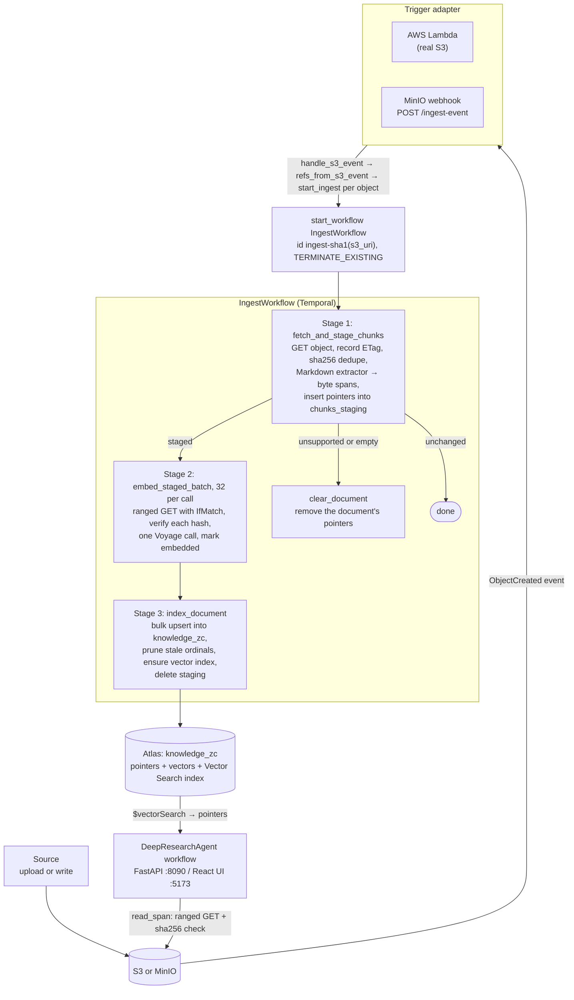
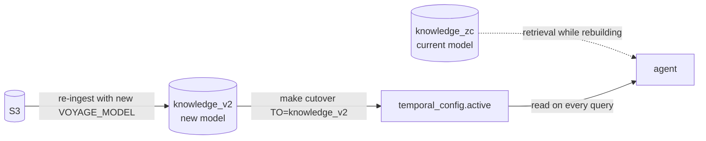
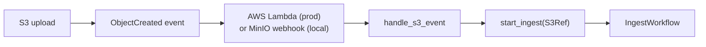

# Low-Level Design

**MongoDB × Temporal Partner Reference Architecture**
Version: 3.0 · Branch: `zero-copy-openai-agents` · Date: 2026-09-24

---

## Table of contents

- [1. Overview](#1-overview)
- [2. Component inventory](#2-component-inventory)
- [3. Data contracts](#3-data-contracts)
- [4. End-to-end data flow](#4-end-to-end-data-flow)
- [5. Workflow design](#5-workflow-design)
  - [5.1 IngestWorkflow](#51-ingestworkflow)
  - [5.2 BackfillWorkflow](#52-backfillworkflow)
- [6. Activity design](#6-activity-design)
- [7. Extractor system](#7-extractor-system)
- [8. MongoDB data model](#8-mongodb-data-model)
- [9. Atlas Vector Search index](#9-atlas-vector-search-index)
- [10. Trigger layer](#10-trigger-layer)
- [11. Agent](#11-agent)
- [12. Configuration reference](#12-configuration-reference)
- [13. Scaling to multiple data sources](#13-scaling-to-multiple-data-sources)
- [14. Scaling to multiple data types](#14-scaling-to-multiple-data-types)
- [15. Extension patterns and future sources](#15-extension-patterns-and-future-sources)

---

## 1. Overview

This implementation is a **durable, event-driven, zero-copy RAG ingestion pipeline** plus a
**durable research agent**, built on two services:

| Layer               | Service       | Role                                                                                  |
| ------------------- | ------------- | ------------------------------------------------------------------------------------- |
| Orchestration       | Temporal      | Ingestion (stage, embed, index) and the agent loop: durable, resumable, observable    |
| Storage + retrieval | MongoDB Atlas | Staged pointers, the searchable pointer collection, the active-model pointer, vector search |

Embeddings and reranking come from **Voyage AI (MongoDB AI)**. The document bytes stay in **S3**
(or MinIO locally), which holds the only copy of the text.

**Zero-copy** means Atlas stores, for each chunk, a byte span into the unmodified source object,
a SHA-256 of those bytes, the embedding, and the object's bucket, key and ETag. It stores no chunk
text. Text comes back only through `pipeline/spanio.py`, which issues a ranged GET conditioned on
the ETag and checks the hash. A chunk whose object changed or vanished reads as `stale` or
`missing` rather than returning old text.

Ingestion is triggered **directly** from an object-created event, with **no Kafka or message
broker**. When the object lands, an AWS Lambda (real S3) or a MinIO webhook (local) starts an
`IngestWorkflow`, and Temporal carries it to completion through failures. This replaced the
earlier Kafka → Sink Connector → `sources` → Atlas Stream Processing chain and its operational
overhead (see ADR `docs/decisions/0001-trigger-ingestion-directly-from-s3.md`).

The design is **source-agnostic** at two seams. One is the `S3Ref` contract plus the
`handle_s3_event` trigger core: a new source is a new adapter that calls `start_ingest`. The other
is the extractor factory: a new file type is one new extractor class, as long as it can express
chunks as byte spans (see §14). Workflows, activities and the Atlas storage layer do not change.

---

## 2. Component inventory

```
pipeline/
├── worker.py               ← Temporal worker (ingestion + agent workflows/activities, 16 activity threads)
├── config.py               ← Pydantic settings (ENV_FILE picks the dotenv file; lru_cache singleton)
├── models.py               ← Data contracts: S3Ref, Span, doc_id_for_uri, sha256_hex (plus legacy Chunk types)
├── clients.py              ← Lazy singletons: Temporal, MongoDB, Voyage, S3 (path style with an endpoint)
├── trigger.py              ← Shared trigger core: handle_s3_event + start_ingest
├── trigger_api.py          ← Webhook endpoint: POST /ingest-event (+ manual /ingest-trigger)
├── lambda_handler.py       ← AWS Lambda entrypoint for real S3 (same handle_s3_event core)
├── s3util.py               ← Parse an S3 / MinIO ObjectCreated event → list[S3Ref]
├── search_index.py         ← Idempotent Atlas Vector Search index management
├── config_store.py         ← Active collection/index/model pointer (cutover)
├── retrieval.py            ← $vectorSearch over the active collection; returns pointers
├── spanio.py               ← The only ranged reader: fetch_range, fetch_span, read_span
├── seed.py                 ← Dev utility: upload a local file and start its ingest
├── seed_repo.py            ← Dev utility: bulk-upload a Markdown docs repo
├── cutover.py              ← Flip the active pointer in temporal_config
├── trigger_backfill.py     ← CLI: start BackfillWorkflow (deferred, see §5.2)
├── workflows/
│   ├── ingest_workflow.py  ← IngestWorkflow: stage, embed in batches of 32, index or clear
│   └── backfill_workflow.py← BackfillWorkflow: paginated, continue-as-new (deferred)
├── activities/
│   ├── ingest.py           ← fetch_and_stage_chunks, embed_staged_batch, index_document, clear_document
│   └── backfill.py         ← read_source_batch, reembed_and_write (raises BackfillDeferred), ensure_target_index
└── extractors/
    ├── base.py             ← Extractor ABC, char-to-byte map, window splitter, RawChunk, UnsupportedSource
    ├── factory.py          ← get_extractor(): Markdown by extension or MIME, else UnsupportedSource
    ├── markdown.py         ← MarkdownExtractor (the only registered extractor)
    └── pdf.py / csv_ext.py / text.py  ← present, not registered (they cannot emit byte spans)

agent/
├── api.py                  ← FastAPI: /research (start), /research/{id} (poll)
├── provider.py             ← build_openai_agents_plugin(): OpenAI directly or a compatible gateway
├── tools.py                ← Agent tools as activities: vector_search_tool, read_span_tool, rerank_tool
├── agent_workflow.py       ← DeepResearchAgent: OpenAI Agents SDK loop as a Temporal workflow
└── ui/                     ← React/Vite chat UI (polls /research for live progress)
```

---

## 3. Data contracts

Defined in `pipeline/models.py` and `pipeline/extractors/base.py`. Contracts are plain Python
`@dataclass`es, so they serialize cleanly through Temporal's default JSON data converter.

### S3Ref

The atomic unit passed into `IngestWorkflow`. Identifies a single object in S3 (or MinIO).

```python
@dataclass
class S3Ref:
    bucket: str          # S3 bucket name
    key: str             # object key (path within bucket)
    s3_uri: str          # "s3://{bucket}/{key}", the canonical identifier
    etag: str            # object ETag from the event (the GET's ETag wins, see §6)
    size: int            # object size in bytes
    content_type: str    # MIME type hint (used by extractor factory)
```

`S3Ref.make(bucket, key, ...)` derives `s3_uri` and strips quotes from the ETag.

### Span and RawChunk

```python
@dataclass
class Span:
    start: int           # byte offset into the unmodified object
    end: int             # exclusive
    kind: str = "byte"

@dataclass
class RawChunk:          # extractor output
    ordinal: int         # position within the document
    text: str            # in memory only, never persisted
    span: Span
    meta: dict           # extractor-specific: section index, heading_span
```

The extractor base enforces one invariant in one place:
`body[span.start:span.end].decode("utf-8") == chunk.text`. Everything downstream relies on it.
Ingestion re-reads spans to embed them, and the agent re-reads them to answer.

### Document identity and deduplication

```python
def doc_id_for_uri(uri: str) -> str:
    # SHA-1 of the URI → 16-char hex. Stable across re-uploads of the same key.
    return hashlib.sha1(uri.encode()).hexdigest()[:16]

def sha256_hex(data: bytes | str) -> str:
    # Whole-object hash for version dedupe; per-span hash for read verification.
    return hashlib.sha256(data).hexdigest()
```

`fetch_and_stage_chunks` short-circuits when the target collection already has a document with
the same `doc_id` and `doc_content_hash`. Identical bytes at the same key are never re-embedded.

---

## 4. End-to-end data flow



No `sources` collection and no broker sit between the event and the workflow. The trigger adapter
calls `start_ingest` directly, and durability begins the instant `start_workflow` returns.

---

## 5. Workflow design

### 5.1 IngestWorkflow

**File:** `pipeline/workflows/ingest_workflow.py`

**Input:** `S3Ref`, optional `target_collection`

**Stages:**

| #   | Activity                            | Timeout                  | Retries                                                  | Idempotent                                                  |
| --- | ----------------------------------- | ------------------------ | -------------------------------------------------------- | ----------------------------------------------------------- |
| 1   | `fetch_and_stage_chunks`            | 5 min                    | 5                                                        | Yes: short-circuits on matching `doc_content_hash`          |
| 2   | `embed_staged_batch` (32 per call)  | 5 min, heartbeat 60 s    | 20 (exp backoff, max 30 s); some errors non-retryable    | Yes: skips chunks already `embedded` with the same model    |
| 3   | `index_document`                    | 2 min                    | 6                                                        | Yes: bulk upsert by `chunk_id`, prune ordinals not written  |
| 3′  | `clear_document` (n = 0 path)       | 2 min                    | 6                                                        | Yes: deletes by `doc_id`                                    |

**Batched embedding:** Stage 2 walks the staged ordinals in contiguous runs of `_EMBED_BATCH`
(32). Spans are monotonic in ordinal, so a run covers one contiguous byte range. Each batch is a
single ranged GET for that range, a SHA-256 check of every span inside it, and one Voyage call:

```python
for start in range(0, n, _EMBED_BATCH):
    await workflow.execute_activity(
        embed_staged_batch,
        args=[doc_id, list(range(start, min(start + _EMBED_BATCH, n))), None],
        start_to_close_timeout=timedelta(minutes=5),
        heartbeat_timeout=timedelta(seconds=60),
        retry_policy=_EMBED_RETRY,
    )
```

Per-chunk reads would cost one request per chunk; a 421 KB file at 1200/150 is about 400 of them.
Batches run one after another, which keeps a single document within Voyage rate limits. Many
documents ingest concurrently as separate workflows.

**Non-retryable embed failures:** `SpanStale` and `SpanMissing` (the object was replaced or
deleted, so the ETag captured at staging can never match again), `RuntimeError` (span
verification failed, or Voyage returned fewer vectors than texts) and `ValueError` (nothing staged
for those ordinals). Retrying them would give a workflow that never completes and never fails.

**Resumability guarantee:** each batch is its own activity, and `embed_staged_batch` skips chunks
already embedded with the active model. If the worker crashes mid-run, Temporal re-runs only the
unfinished batches.

**Unsupported, empty or undecodable sources:** Stage 1 returns `n = 0` with a reason (a
non-Markdown object, no chunks, or bytes that are not valid UTF-8). The workflow then runs
`clear_document` instead of returning, so an earlier version of that key does not stay searchable
and citable.

**Update-in-place:** re-uploading the same key with new content yields a new `doc_content_hash`.
Stage 1 clears stale staging rows and records the new ETag, Stage 2 re-embeds, and Stage 3 upserts
into `knowledge_zc` and deletes that document's chunks whose ordinal was not written this time.

**Workflow ID / dedupe:** the id is `ingest-<sha1(s3_uri)>` (stable per object key) with
`WorkflowIDConflictPolicy.TERMINATE_EXISTING`. A re-upload during an in-flight ingest terminates
that run and starts fresh, so there is never a duplicate or a race. The same applies when both
the MinIO webhook and `make seed` start the same object.

### 5.2 BackfillWorkflow

**File:** `pipeline/workflows/backfill_workflow.py`

**Status: deferred on zero-copy.** The workflow is still registered and still paginates with
`continue_as_new`, but `reembed_and_write` raises a non-retryable `ApplicationError` of type
`BackfillDeferred` on its first call. Re-embedding needs chunk text, and `knowledge_zc` stores
none. A backfill would have to re-read every span from S3, which is the same work as re-ingesting.

**Model change today:** re-ingest from S3 into a second collection, then cut over (steps in
`docs/RUNBOOK.md` §9). The blue/green mechanics are unchanged:

- `temporal_config.active` names the collection, index, model and dimension retrieval uses.
- `make cutover TO=<collection>` rewrites that document, reading model and dimension from a
  document in the target.
- The agent reads the pointer on every query, so no restart is needed, and the old collection
  stays for rollback.



---

## 6. Activity design

All activities follow three rules:

1. **Idempotent.** Safe to retry; re-running a completed activity produces no duplicate writes.
2. **Heartbeating.** `embed_staged_batch` heartbeats after each slow step (the ranged GET, the
   hash check and the Voyage call), not once up front, so a heartbeat always reports progress
   that has happened.
3. **Sync execution.** Activities use standard `pymongo`, `voyageai` and `boto3` clients and run
   in the worker's `ThreadPoolExecutor(max_workers=16)`, keeping the Temporal event loop free.

The ETag that every later ranged read is conditioned on comes from the Stage 1 GET, not from the
event. The poll path may not carry one, and the GET is authoritative.

### Activity retry policy (embed activity)

```python
RetryPolicy(
    initial_interval=timedelta(seconds=2),
    backoff_coefficient=2.0,
    maximum_interval=timedelta(seconds=30),
    maximum_attempts=20,
    non_retryable_error_types=["SpanStale", "SpanMissing", "RuntimeError", "ValueError"],
)
```

Voyage rate limits (429), a throttled provider and transient network errors are retried. Failures
that cannot succeed later fail the workflow immediately (see §5.1).

---

## 7. Extractor system

**File:** `pipeline/extractors/`

The extractor factory decouples file-type handling from the workflow. On this branch it only
registers Markdown: a partially zero-copy collection, with some documents stored as text, is
worse than an honest gap.

### Base class

```python
class Extractor(ABC):
    name: str
    chunk_size: int
    chunk_overlap: int

    @abstractmethod
    def ranges(self, text: str, c2b: Sequence[int]) -> list[tuple[int, int, dict]]:
        """Ordered (char_start, char_end, meta) triples over the decoded text.
        Offsets placed in meta must already be byte offsets (converted through c2b)."""

    def chunk(self, body: bytes) -> list[RawChunk]:
        """Decode strictly as UTF-8, build one char-to-byte prefix array,
        convert each range to a byte Span, assign ordinals."""
```

`chunk()` raises `UnsupportedSource` if the body is not valid UTF-8 or the byte map does not
cover the object. The prefix array is built once per document; re-encoding a prefix per chunk
would be quadratic on a 400-chunk file.

### Chunking strategy

`window_indices()` is a character window with overlap that returns index pairs rather than
strings, trimming whitespace at both edges. Default: `chunk_size=1200`, `chunk_overlap=150`
(configurable in the env file).

### Registered extractors

| Extension / MIME                                          | Extractor           | Chunking strategy                                                        |
| --------------------------------------------------------- | ------------------- | ------------------------------------------------------------------------ |
| `.md`, `.markdown` / `text/markdown`, `text/x-markdown`   | `MarkdownExtractor` | Section-aware: splits on `#` headings, then window-splits long sections  |
| anything else                                             | none                | `UnsupportedSource`; the workflow clears the document                    |

Resolution order: **file extension, then MIME type**. `pdf.py`, `csv_ext.py` and `text.py` are
in the directory but not registered.

---

## 8. MongoDB data model

Database: `temporal` (configurable via `MONGODB_DB`; use a separate one per bucket, see the
RUNBOOK's MinIO section)

### `chunks_staging` collection

Transient. Written by `fetch_and_stage_chunks`, updated by `embed_staged_batch`, deleted by
`index_document` or `clear_document`. Survives worker crashes, so the workflow resumes from the
right batch. Holds pointers, never text.

```json
{
  "doc_id": "a3f9c1d2e4b5f678",
  "chunk_id": "a3f9c1d2e4b5f678:0",
  "ordinal": 0,
  "span": { "kind": "byte", "start": 0, "end": 1187 },
  "content_hash": "sha256hex",
  "doc_content_hash": "sha256hex",
  "source_uri": "s3://temporal-datasources/seed/ethical_governance.md",
  "bucket": "temporal-datasources",
  "key": "seed/ethical_governance.md",
  "etag": "9b2cf535f27731c974343645a3985328",
  "metadata": { "section": 0, "heading_span": { "start": 2, "end": 40 }, "extractor": "markdown" },
  "extractor": "markdown",
  "status": "pending | embedded",
  "embedding": null,
  "model": "voyage-3.5",
  "dim": 1024
}
```

`model` and `dim` appear once the chunk is embedded. Indexes: `chunk_id` (unique),
`{ doc_id: 1, status: 1, ordinal: 1 }`.

### `knowledge_zc` collection (active)

The searchable store. `index_document` upserts it in one `bulk_write`, keyed by `chunk_id`.

```json
{
  "doc_id": "a3f9c1d2e4b5f678",
  "chunk_id": "a3f9c1d2e4b5f678:0",
  "ordinal": 0,
  "span": { "kind": "byte", "start": 0, "end": 1187 },
  "content_hash": "sha256hex",
  "doc_content_hash": "sha256hex",
  "embedding": [0.123, ...],
  "model": "voyage-3.5",
  "dim": 1024,
  "source_uri": "s3://temporal-datasources/seed/ethical_governance.md",
  "bucket": "temporal-datasources",
  "key": "seed/ethical_governance.md",
  "etag": "9b2cf535f27731c974343645a3985328",
  "metadata": { "section": 0, "heading_span": { "start": 2, "end": 40 }, "extractor": "markdown" }
}
```

There is no `text` field, and nothing in retrieval projects one. Indexes: `chunk_id` (unique),
`{ doc_id: 1, doc_content_hash: 1 }`, `{ doc_id: 1, ordinal: 1 }`.

### `knowledge_v2` collection

Same schema and indexes as `knowledge_zc`. The second collection for a model change by
re-ingest (§5.2). Becomes active after `make cutover TO=knowledge_v2`.

### `temporal_config` collection

Single document: the active pointer. Read on every query. When it is absent, retrieval falls back
to `KNOWLEDGE_COLLECTION`, `VOYAGE_MODEL` and `EMBED_DIM` from settings.

```json
{ "_id": "active", "active_collection": "knowledge_zc", "active_index": "temporalai_search_index",
  "model": "voyage-3.5", "dim": 1024 }
```

### `agent_memory` collection

Reserved for agent memory. **Not currently written** by any code path: the research agent does
not persist memory yet. Atlas remains the intended store for it (same database as retrieval), and
wiring it into the agent loop is a follow-up.

---

## 9. Atlas Vector Search index

**File:** `pipeline/search_index.py`

Created idempotently by `ensure_vector_index` at the end of every `index_document`, and by
`make index` ahead of time:

```json
{
  "fields": [
    { "type": "vector", "path": "embedding", "numDimensions": 1024, "similarity": "cosine" },
    { "type": "filter", "path": "doc_id" },
    { "type": "filter", "path": "source_uri" }
  ]
}
```

The `filter` fields let retrieval scope to a document or source URI without a full scan.
`ensure_vector_index` lists existing indexes and skips creation if one is present.
`numDimensions` comes from the embedded chunks' `dim` (in `index_document`) or `EMBED_DIM` (in
`make index`).

---

## 10. Trigger layer

The trigger turns an S3 **ObjectCreated** event into the start of an `IngestWorkflow`. Every
adapter goes through one shared, source-agnostic core in `pipeline/trigger.py`:

```python
async def handle_s3_event(client, event) -> list[str]:
    # parse the event envelope → S3Ref[]; start one IngestWorkflow per object
    return [await start_ingest(client, ref) for ref in refs_from_s3_event(event)]

async def start_ingest(client, ref: S3Ref) -> str:
    handle = await client.start_workflow(
        "IngestWorkflow", ref,
        id=f"ingest-{doc_id_for_uri(ref.s3_uri)}",
        task_queue=settings.temporal_task_queue,
        id_conflict_policy=WorkflowIDConflictPolicy.TERMINATE_EXISTING,
    )
    return handle.id
```

`refs_from_s3_event` (`s3util.py`) parses the standard `Records[*].s3` envelope (AWS and MinIO
share the shape; SNS-wrapped and `s3:TestEvent` bodies are handled) and URL-decodes the key.

### Local dev: MinIO webhook → `trigger_api.py`

MinIO's native **webhook** notification POSTs each ObjectCreated event to `POST /ingest-event`.
The endpoint reuses one cached Temporal client (FastAPI lifespan) and calls the shared core:

```python
@app.post("/ingest-event")
async def ingest_event(request: Request) -> dict:
    event = await request.json()
    return {"started": await handle_s3_event(request.app.state.temporal, event)}
```

MinIO uses a `queue_dir`, so events that arrive before the host `trigger_api` is up are buffered
and replayed (at-least-once locally). A manual `POST /ingest-trigger {bucket, key}` endpoint is
also provided for scripted and test triggers. `infra/docker-compose.yml` defines MinIO and a
one-shot `minio-setup` container that creates the bucket and subscribes it to the webhook.

### Production: AWS Lambda → `lambda_handler.py`

In production, an AWS Lambda subscribed to the bucket's S3 event notifications runs the **same**
core:

```python
def lambda_handler(event, context) -> dict:
    return {"started": asyncio.run(_run(event))}   # _run connects a client, calls handle_s3_event
```

Same parsing, same `start_ingest`, same durability guarantee. The local webhook stands in for this
Lambda. Deploy notes are in `docs/RUNBOOK.md` §10.

---

## 11. Agent

The research agent runs over the same Atlas pointers the pipeline wrote, in the same Voyage
embedding space, and reads text from the same bucket.

### DeepResearchAgent: `agent/agent_workflow.py`

The agent's reasoning loop runs **as a Temporal workflow** (`DeepResearchAgent`) through the
OpenAI Agents SDK integration (`temporalio.contrib.openai_agents`). Model calls run as activities
with a 120 s start-to-close timeout. The agent decides which tools to call and how often, and the
whole trajectory is durable, resumable and inspectable in the Temporal UI.

- **Tools** (`agent/tools.py`), all Temporal activities wrapped with `activity_as_tool`, 30 s
  timeout each:

  | Tool                 | Input                          | Returns                                                                             |
  | -------------------- | ------------------------------ | ----------------------------------------------------------------------------------- |
  | `vector_search_tool` | `query`, `k=10`                | `chunk_id`, `source_uri`, `ordinal`, `span`, `score`. No text                       |
  | `read_span_tool`     | `chunk_id`                     | `status` (`ok`, `stale`, `missing`, `unknown`); `text` only when `ok`               |
  | `rerank_tool`        | `query`, `chunk_ids`, `top_k=5` | Top chunks with `rerank_score` and verified `text`; spans that fail to verify are dropped |

- **Hosted web search:** `WebSearchTool` is added only when `OPENAI_USE_RESPONSES=true`. It runs
  inside the model-call activity, and Chat Completions cannot host it.
- **Instructions:** decompose multi-part questions and search each sub-topic with a focused
  query, issue independent searches and reads in the same turn, prefer the ingested documents
  over the web, and cite inline with `[n]`. Never answer from the model's own background
  knowledge; if the sources do not cover the question, say so. Without web search, the
  instructions also tell the model that it has none.
- **Parallel tool calls:** `ModelSettings(parallel_tool_calls=True)`. Independent calls from one
  turn run as concurrent activities.
- **Turn limit:** `AGENT_MAX_TURNS` (12). `MaxTurnsExceeded` is converted to a non-retryable
  `ApplicationError`, so the run fails visibly. Left alone, it would fail the workflow task,
  which Temporal retries forever.
- **Live progress:** run hooks append readable steps ("Searching the docs…", "Reading the
  source…", "Reranking results…") to workflow state exposed through a `progress` **query**.
  `POST /research` starts the workflow and returns a `workflow_id`; the UI polls
  `GET /research/{id}` for `status`, `steps`, `tool_calls`, `answer`, `model` and `done`
  (step level, not token streaming).
- **Opt-in:** the agent and `OpenAIAgentsPlugin` load only when `OPENAI_API_KEY` is set. Without
  it the worker runs ingestion only, and `POST /research` returns 503.

### Model provider: `agent/provider.py`

`build_openai_agents_plugin()` is shared by the worker and the agent API so both use the same
endpoint. With no `OPENAI_BASE_URL` it is the SDK default (api.openai.com, Responses API). With
one, it builds an `AsyncOpenAI` client for that URL, optionally sends the key in the header named
by `OPENAI_API_KEY_HEADER` as well as the Bearer token, selects Chat Completions when
`OPENAI_USE_RESPONSES=false`, and disables trace export (a gateway key cannot authenticate to
api.openai.com).

### Vector search query (`pipeline/retrieval.py`)

```python
pipeline = [
    { "$vectorSearch": {
        "index": active["active_index"], "path": "embedding", "queryVector": query_embedding,
        "numCandidates": max(100, k * 20), "limit": k,
    }},
    { "$project": { "_id": 0, "source_uri": 1, "chunk_id": 1, "ordinal": 1, "span": 1,
                    "metadata": 1, "score": { "$meta": "vectorSearchScore" } } },
]
```

The query is embedded with the **active** model from `temporal_config`, so it matches the
collection's vector space after a cutover. The projection has no `text`. Asking for it would
silently return nothing rather than fail.

### Span reads (`pipeline/spanio.py`)

`read_span(chunk_id)` is the model-facing resolver, and the only path from a pointer back to text:

1. Look up the pointer by `chunk_id` in the active collection. Not found: `unknown`.
2. Check the pointer's shape: `bucket`, `key`, `etag`, `content_hash` as non-empty strings, and
   `span.start`/`span.end` as integers with `0 <= start < end`. Malformed: `unknown`, without
   spending a GET.
3. `GetObject` with `Range=bytes=start-(end-1)` and `IfMatch=etag`. Precondition failed: `stale`.
   No such key or bucket: `missing`.
4. Decode strictly as UTF-8 (failure: `stale`) and compare SHA-256 with `content_hash`
   (mismatch: `stale`).
5. Otherwise `ok`, with `text`.

It takes only a `chunk_id` on purpose. A model that could pass a bucket, key and range could read
any object the worker's credential reaches, and a caller-supplied hash would certify whatever it
found. Only `ok` ever carries text; a document that happens to hold a `text` field is never read
from.

---

## 12. Configuration reference

All settings live in one dotenv file, `.env` unless `ENV_FILE` names another (loaded by
`pipeline/config.py` via Pydantic Settings). Values in the file take precedence over exported
environment variables.

| Variable                  | Default                     | Description                                                          |
| ------------------------- | --------------------------- | -------------------------------------------------------------------- |
| `ENV_FILE`                | `.env`                      | Which dotenv file to read (e.g. `.env.minio`). Also read by the Makefile |
| `MONGODB_URI`             | none                        | Atlas connection string (required)                                   |
| `MONGODB_DB`              | `temporal`                  | Database name. Use one per bucket                                    |
| `CHUNKS_COLLECTION`       | `chunks_staging`            | Transient staging between workflow stages                            |
| `KNOWLEDGE_COLLECTION`    | `knowledge_zc`              | Searchable pointers and vectors (no text)                            |
| `KNOWLEDGE_V2_COLLECTION` | `knowledge_v2`              | Second collection for a model change                                 |
| `CONFIG_COLLECTION`       | `temporal_config`           | Active pointer document                                              |
| `MEMORY_COLLECTION`       | `agent_memory`              | Reserved for agent memory (not yet written)                          |
| `VECTOR_SEARCH_INDEX_NAME`| `temporalai_search_index`   | Vector index name                                                    |
| `VOYAGE_API_KEY`          | none                        | Voyage AI key (embeddings + rerank)                                  |
| `VOYAGE_BASE_URL`         | `https://ai.mongodb.com/v1` | Voyage endpoint. `https://api.voyageai.com/v1` for a voyageai.com key |
| `VOYAGE_MODEL`            | `voyage-3.5`                | Embedding model (1024-dim)                                           |
| `VOYAGE_RERANK_MODEL`     | `rerank-2.5`                | Reranking model                                                      |
| `EMBED_DIM`               | `1024`                      | Embedding dimensionality (must match the model)                      |
| `OPENAI_API_KEY`          | none                        | Enables the research agent                                           |
| `OPENAI_BASE_URL`         | blank                       | OpenAI-compatible gateway; blank means api.openai.com                |
| `OPENAI_API_KEY_HEADER`   | blank                       | Also send the key in this header (e.g. `api-key`)                    |
| `OPENAI_USE_RESPONSES`    | `true`                      | `false` selects Chat Completions and drops hosted web search         |
| `AGENT_MODEL`             | `gpt-4.1`                   | Model for the agent loop                                             |
| `AGENT_MAX_TURNS`         | `12`                        | Guardrail on the agent tool-use loop                                 |
| `CHUNK_SIZE`              | `1200`                      | Maximum characters per chunk                                         |
| `CHUNK_OVERLAP`           | `150`                       | Overlap characters between adjacent chunks                           |
| `TEMPORAL_ADDRESS`        | `localhost:7233`            | Temporal server address                                              |
| `TEMPORAL_NAMESPACE`      | `default`                   | Temporal namespace                                                   |
| `TEMPORAL_TASK_QUEUE`     | `temporal-pipeline`         | Worker task queue                                                    |
| `TRIGGER_API_PORT`        | `8088`                      | Webhook trigger endpoint port                                        |
| `AGENT_API_PORT`          | `8090`                      | Agent API port                                                       |
| `AWS_REGION`              | `us-east-1`                 | S3 region                                                            |
| `AWS_ACCESS_KEY_ID` / `AWS_SECRET_ACCESS_KEY` | blank   | Explicit credentials; blank uses the boto3 credential chain          |
| `S3_BUCKET`               | blank                       | Source bucket (required)                                             |
| `S3_ENDPOINT_URL`         | blank                       | S3-compatible endpoint, e.g. `http://localhost:9000` for MinIO; blank means AWS S3 |

---

## 13. Scaling to multiple data sources

The design is **source-agnostic at the trigger seam**. Any adapter that can build an `S3Ref` and
call `start_ingest` feeds the pipeline, with no broker. The workflow, activities and storage layer
stay the same for every source; only the adapter differs.

Zero-copy adds one requirement: the agent reads text back from the object at query time, so the
source object has to stay readable at the pointer's bucket and key, with the same ETag, for as long
as its chunks are searchable.

### Current source: S3 / MinIO



### Adding a new source: general pattern

```
Step 1:  A source event fires (object store, queue, CDC, webhook).
Step 2:  A thin adapter (Lambda, small consumer, HTTP handler) turns it into an S3Ref
         (for inline content, it uploads to S3 first) and calls start_ingest / handle_s3_event.
```

There is no `sources` collection, no sink connector and no change-stream watcher to operate.

### Source examples

- **SQS-driven S3 or other queues:** a small consumer calls `start_ingest` per message. No queue
  consumer ships in this repo.
- **RDBMS / CDC (Debezium, etc.):** a small consumer receives change events, writes the content
  to S3, and calls `start_ingest`. Inline content with no object behind it cannot be zero-copy,
  because there would be nothing for `read_span` to read.
- **Existing Atlas data (change stream):** an Atlas trigger or a watcher process writes the
  document to S3 and calls `/ingest-event` (or `start_ingest`).
- **Webhook / HTTP (Notion, GitHub, …):** POST to `trigger_api`; the handler uploads the payload
  to S3 and builds an `S3Ref`.

### Multi-source worker scaling

The Temporal worker is stateless. Scale horizontally by running more worker processes on the same
task queue; Temporal distributes workflow and activity tasks across them. Per-worker concurrency
is `ThreadPoolExecutor(max_workers=16)`. Tune it to the embedding API rate limit.

```bash
uv run python -m pipeline.worker &   # worker 1
uv run python -m pipeline.worker &   # worker N
```

---

## 14. Scaling to multiple data types

The extractor factory (`pipeline/extractors/factory.py`) is the only extension point for new file
or data types. Workflows and activities are type-agnostic: they receive `bytes` and call
`get_extractor(key, content_type).chunk(body)`.

### Adding a new extractor

1. Create `pipeline/extractors/my_format.py` subclassing `Extractor`, implementing `ranges()`.
2. Register it in `factory.py` (`_BY_EXT["myext"] = MyFormatExtractor`, and/or `_BY_MIME[...]`).
3. No changes to workflows, activities or the Atlas data model.

The constraint is the span invariant from §3: every chunk's text must be the UTF-8 decoding of a
contiguous byte range of the unmodified object. Plain-text formats (HTML, JSON, source code, CSV
read as text) meet it. PDF, DOCX and XLSX do not, because their text is reconstructed rather than
stored as bytes. That is why `pdf.py` and `csv_ext.py` are not registered. Supporting them
zero-copy needs a different pointer kind (page and character offsets into a stored extraction,
for example) and a matching reader in `spanio.py`. That design is not done.

### Current extractors

| Extractor           | `ranges()` strategy                                           | Metadata emitted                    |
| ------------------- | ------------------------------------------------------------- | ----------------------------------- |
| `MarkdownExtractor` | Split on `#` to `######` headings; window-split long sections | `section`, `heading_span` (bytes)   |

The heading is carried as a byte range, not as text, so the metadata holds no copy of the
document either.

### Chunking parameter tuning

| Use case                             | `CHUNK_SIZE` | `CHUNK_OVERLAP`                 |
| ------------------------------------ | ------------ | ------------------------------- |
| Long narrative docs (Markdown)       | 1200         | 150                             |
| Short structured records             | 512          | 64                              |
| Code files                           | 800          | 200 (preserve function context) |

---

## 15. Extension patterns and future sources

### Multi-tenant / multi-database

Parameterize `IngestWorkflow(ref, target_collection="customer_a_knowledge")`; the argument
threads through every stage, including the `unchanged` check. Point the active pointer at the
tenant collection.

### Parallel ingestion

Fan out multiple `IngestWorkflow` starts (each is independent and works on disjoint `doc_id`s):

```python
await asyncio.gather(*[start_ingest(client, ref) for ref in refs])
```

### Incremental sync (change-driven dedupe)

The content-hash check in `fetch_and_stage_chunks` gives incremental sync for free:

- Same key, same content: `status: unchanged`, returns immediately, no embedding call.
- Same key, new content: re-embed; `index_document` updates in place and prunes stale chunks.
  Until that finishes, reads of the old chunks return `stale`, because the ETag changed.
- Same key, now unsupported or empty: `clear_document` removes its chunks.
- New key: full ingest.

A deleted object is the one change this does not catch, since no ObjectCreated event fires. Its
chunks stay in the index, and `read_span` reports them as `missing`. A reconciliation sweep (below)
or an ObjectRemoved trigger that calls `clear_document` would close that gap.

### Scheduled reconciliation / full re-sync

The object store (S3) is the source of truth, so a **Temporal Scheduled Workflow** can list the
bucket and start `IngestWorkflow` for each key, relying on content-hash dedupe to skip unchanged
docs. This is also the backstop for a dropped source-event notification, the one best-effort hop,
on par with any broker-based design (see ADR 0001 "Delivery semantics"):

```python
@workflow.defn
class FullSyncWorkflow:
    @workflow.run
    async def run(self, prefix: str) -> dict:
        keys = await workflow.execute_activity(list_s3_keys, args=[prefix], ...)
        for key in keys:
            ref = S3Ref.make(bucket=settings.s3_bucket, key=key)
            await workflow.execute_child_workflow(IngestWorkflow, args=[ref], ...)
        return {"synced": len(keys)}
```

### Model A/B testing

Re-ingest into a third collection with a different `VOYAGE_MODEL`, point a shadow agent's active
pointer at it, and compare retrieval quality before cutting over.

### Observability hooks

Each activity emits structured logs via `activity.logger`, and every tool and model call the
agent makes is workflow history. Query Temporal visibility (or Temporal Cloud search) by
`source_uri`, `doc_id` or workflow id. A rising share of `stale` or `missing` span reads is the
signal that the index has drifted from the bucket.
